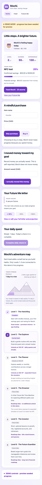
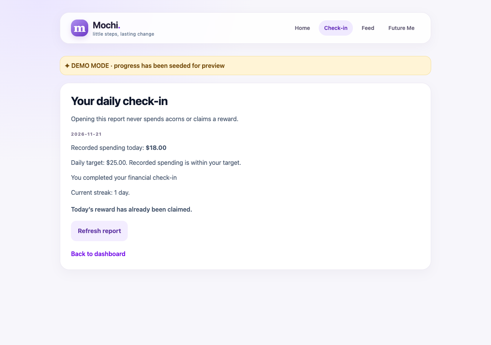

# Addendum verification — November 21, 2026

Story: a primary NFC/QR URL opens `/check-in`, which reads the daily report
through the central adapter and SQLite projections. The page claims a reward
only after an explicit check-in. Legacy in-app feeding remains available.
Preferences, budgets, manual transactions, insights, reflections and lesson
methods work in both the native API and the frontend mock.

## Observed boundaries

| Boundary | Result | Evidence |
| --- | --- | --- |
| UI renders | Passed | Inspected 390 × 844 and 1280 × 900 screenshots below; no horizontal overflow |
| Client → API | Passed | Browser imported the actual `httpApi` via Vite and exercised all twelve new routes; explicit page action posted `/api/check-ins` |
| API → SQLite | Passed | 15 HTTP/process tests, including concurrent requests, cents inspection, injected save failures and restart |
| Data → response | Passed | 115 existing V1 transitions and 50 new native API/actual FE mock comparisons |
| Response → UI | Passed | Daily target, $18 spending, completion and already-claimed state rendered; failed report and retry covered in the UI journey test |

## Automated checks

Node 22.23.5 and pnpm 10.34.9 were used. A frozen-lockfile offline install using
the existing pnpm cache succeeded; hooks were installed normally. `pnpm check`
passed through the normal pre-commit hooks, covering hook validation, all
workspace typechecks, 9 contract tests, 16 domain tests, 15 frontend tests, native
core tests, 15 HTTP/process tests, the launcher test, 6 poller tests, both
comparison suites, and production API/web builds. No dependency or lockfile
changes were needed. Existing nonfatal Zod/Rollup annotation warnings remain.

Coverage includes strict input validation; null budget limits; offset timestamps
at local month boundaries; exact 24-hour reflection eligibility; the 75% mature
tree stage; separate confirmed/potential savings; wrong/correct lesson answers;
once-per-lesson rewards; check-in route aliases, local midnight and new UUIDs;
failed-ID reuse; and atomic rollback of rewards, records and reactions.

The v1 migration test reconstructed the original SQLite payload keys and schema
version, retaining account values, original whitespace/newline letter text,
decision rows, successful request rows and a live feed reaction cursor. Restart
upgraded to SQLite version 2. Every original value/history row matched, feed and
decision UUID replay stayed deduplicated, and a further restart remained intact.
All of this used temporary databases; no user database was changed.

## Observed browser rehearsal

The optional `test:hardware` harness ran against isolated native API/Vite
processes and Chrome using the existing external Playwright installation:

- Opened, reloaded and cancelled the legacy feed URL without spending or a
  reaction. Explicit confirmation made exactly one feed request, reducing 60 to
  40 acorns and setting fullness to 80. Same UUID replay changed nothing.
- The temporary fake controller observed one wag/sound call. This verifies
  software dispatch, not a physical motor, speaker or Raspberry Pi.
- The launcher printed `/check-in` as the primary NFC URL. Opening, reloading
  and refreshing that report left state unchanged. Explicit confirmation awarded
  10 acorns/20 XP once; a later fresh-ID check-in awarded zero.
- Exercised preferences, limits, four manual transactions and one transaction
  retry through the real browser adapter: $72 recorded this month, $18 today,
  $428 remaining of a $500 limit, and a $25 daily target.
- Observed a three-purchase frequency insight totaling $54, reflected one of
  three due records, and observed two remaining. No psychological labels.
- Answered a lesson correctly and retried: 10 XP once, then zero. Confirmed
  savings and original letter stayed unchanged throughout spending actions.
- Reloaded the page and inspected both viewport sizes. UI uses acorns while
  the HTTP/storage field remains `wallet.coins`.

## External checks and boundaries

No physical phone, NFC/QR scan, Raspberry Pi, motor or speaker was exercised.
`daily_checkin` and `goal_milestone` reaction names remain reserved until hardware
agreement. The existing five-key device projection is preserved; it contains no
transactions, letter, names or goal metadata. Device routes still require
`ENABLE_DEVICE_API=true`.

Dedicated budget, transaction, reflection and lesson screens are outside this
API/mock addendum; their typed methods and native endpoints are implemented.
The new daily report page and existing dashboard/feeding UI are the affected
browser journeys. No deployment, push or remote PR merge was performed.
