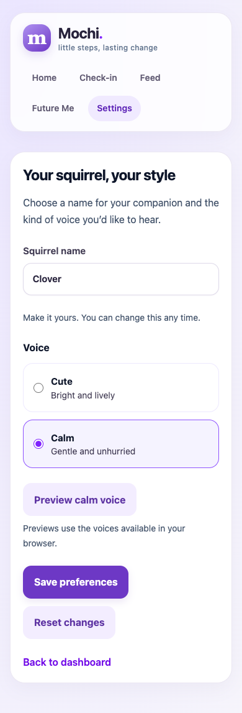
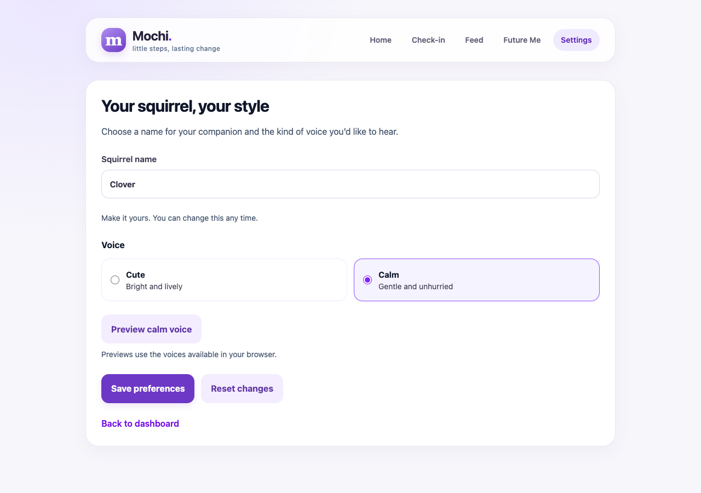

# Squirrel name and voice settings — November 21, 2026

Users can name or rename their squirrel and choose the cute or calm voice from
Settings (`/settings`). The form uses the central API adapter; the C++ service
persists the result in SQLite. The mock uses the same schema and shared update
rules. Existing onboarding and voice-only API clients remain compatible.

## Contract and validation

`PUT /api/preferences` accepts optional `petName` and optional `voice`, with at
least one present. Omitted fields keep their current value. Name validation trims
surrounding whitespace, rejects empty names, and caps at 200 UTF-16 code units
as in native onboarding; cute/calm are the only allowed voices. Empty bodies,
unknown fields, nulls, invalid voices and overlong names return 400 atomically.

Name remains in `pet.name` / account petName; preferences state remains `{voice}`.
There is no second persisted name, new table, schema reset or migration. The
existing account fields preserve name/voice across restart. Updates grant no
reward and leave goal, letter, coins, XP, pet fullness, quest and reaction cursor
unchanged. Legacy device state is not expanded with a name or voice.

```sh
curl -X PUT http://localhost:3000/api/preferences -H 'Content-Type: application/json' \
  -d '{"petName":"Clover","voice":"calm"}'
curl -X PUT http://localhost:3000/api/preferences -H 'Content-Type: application/json' \
  -d '{"voice":"cute"}'
curl -X PUT http://localhost:3000/api/preferences -H 'Content-Type: application/json' \
  -d '{"petName":"Maple"}'
```

## Voice behavior

Selection and preview are draft-only until Save preferences. Cute uses a brighter
pitch/faster rate; calm uses a lower pitch/slower rate. Preview is explicit and
uses browser/OS speech synthesis with a fixed sample, not letter or spending
content. Speech is stopped on tone changes, reset, save and page exit. Late
speech events cannot overwrite the current preview status. Unsupported browsers,
audio errors and timeouts show a fallback while allowing preference saves.

The preference is persisted; this feature does not change Pi/device speech or
hardware protocols. Unit tests verify distinct pitch/rate configuration using a
speech-driver stub. The browser rehearsal invoked the real browser preview API,
but actual audible output, a physical speaker and Pi playback were not verified.

## Observed verification

| Boundary | Result | Evidence |
| --- | --- | --- |
| UI loading and rendering | Passed | Delayed initial GET showed loading; inspected 390×844 and 1280×900 screenshots with no horizontal overflow |
| Draft → adapter | Passed | Name/radio changes and preview sent no PUT; explicit Save sent trimmed petName and selected voice |
| Failure → retry | Passed | Delayed forced HTTP 500 showed disabled Saving state, retained the draft and allowed retry; UI unit test also covers a response lost after mock commit |
| API → SQLite | Passed | Native test injected a failed UPDATE: neither field changed; successful two-field update survived a process restart |
| Response → UI | Passed | Saved Clover/calm appeared in settings after restart and the dashboard displayed Clover |
| State invariants | Passed | Original letter/goal/rewards remained identical; private five-key device state stayed unchanged |

Using Node **22.23.5** / pnpm **10.34.9**, `pnpm check` passed through normal
hooks: typechecks, contract/domain/UI tests, all four native CTest targets,
**115 V1 transitions** and **59 native API/actual mock requests**, and production
builds. There are 10 contract, 17 domain and 18 frontend tests; native HTTP has
16 scenarios, including the new independent-update/restart/rollback check.
Existing nonfatal Zod/Rollup annotation warnings remain. No dependency or root
lockfile changes; the new web script only runs the optional browser rehearsal.

For repeatable browser verification, build the native API first and use an
existing Playwright installation without adding a workspace dependency:

```sh
PLAYWRIGHT_MODULE=/absolute/path/to/playwright/index.mjs \
PLAYWRIGHT_BROWSER_EXECUTABLE='/Applications/Google Chrome.app/Contents/MacOS/Google Chrome' \
pnpm --filter @mochi/web test:preferences-browser
```

The harness refuses occupied 3000/5173 ports, uses a temporary SQLite file,
starts/stops only its own native API/Vite/Chrome processes, and cleans up. On
Linux omit the executable override when Playwright Chromium is installed.





## Review and remaining checks

The focused `contract/pet-preferences` branch targets main. Runtime work on
`feat/pet-preferences` is stacked on that contract, which must land first; then
rebase consumers onto the accepted main tip. No branch is merged by this task.
The existing forest backend branch and the separate mock-v2 PR are unchanged.

PR-template validation: checks and Conventional Commit hooks pass; input/response
compatibility, loading, invalid/empty input, error/retry, reset and success are
covered; dependencies/lockfile are unchanged. Existing installed dependencies
were used rather than repeating installation. Shared-contract acceptance remains
pending the focused PR. Browser mobile emulation, native restart and feeding/
private-state compatibility are observed, but physical phone/NFC/Pi/audio checks
were not performed. No deployment or production/user database was modified.
